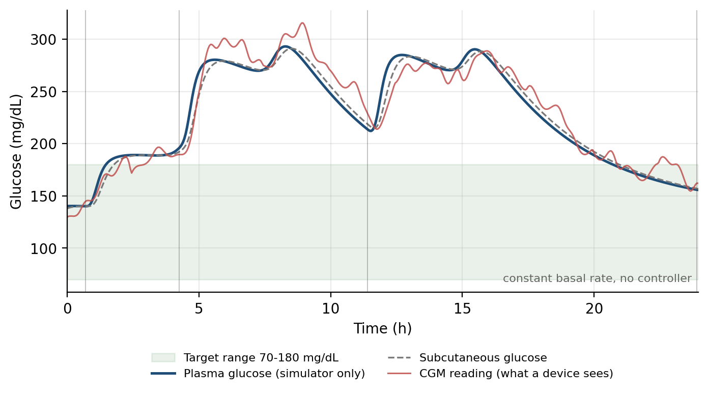
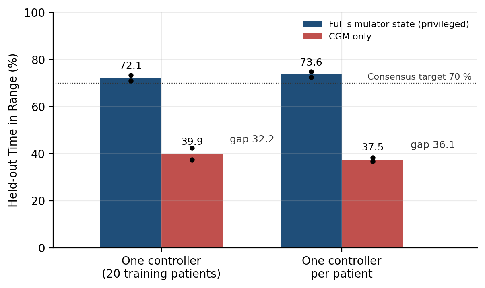
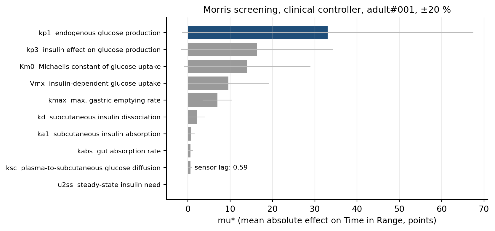
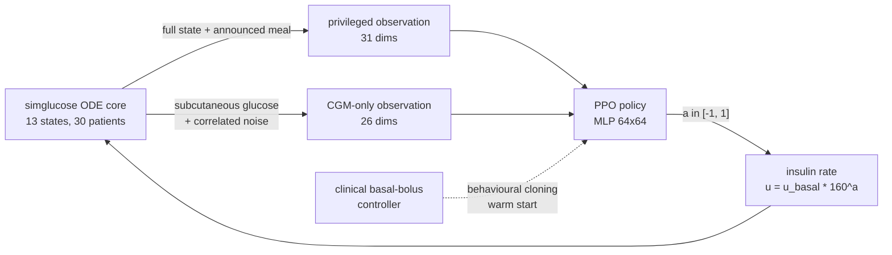

# Insulin dosing with PPO: full simulator state vs. sensor only

Two PPO agents dose insulin for simulated type 1 diabetes patients (UVA/Padova model,
[simglucose](https://github.com/jxx123/simglucose)). They are trained under identical conditions; one sees
the full simulator state, the other only the noisy, delayed glucose sensor (CGM) that a real device has. The
sensor-only agent loses about 34 points of Time in Range (38-40 % vs. 72-74 %). Before a meal the sensor
shows nothing yet, and a 5x longer sensor history doesn't help.

Solo project, 2026, grade 1.0.



*One simulated day without any controller (constant basal rate only), so glucose stays high. A real
controller only gets the noisy red curve, which lags plasma glucose by 12 minutes. Vertical lines are
meals.*

## Results

Time in Range (TIR, 70-180 mg/dL) on 10 held-out patients, 200 simulated days per cell, two independent
training runs each:

| Controller | Run 1 | Run 2 | Mean |
|---|---|---|---|
| PPO, privileged, one controller for 20 training patients | 71.0 % | 73.3 % | **72.1 %** |
| PPO, privileged, one controller per patient | 74.8 % | 72.4 % | **73.6 %** |
| PPO, CGM only, one controller for 20 training patients | 42.4 % | 37.4 % | **39.9 %** |
| PPO, CGM only, one controller per patient | 36.7 % | 38.3 % | **37.5 %** |
| PPO, CGM only, one controller for 20 training patients, 180 min sensor window instead of 36 min | 37.7 % | 39.5 % | 38.6 % |



- **Information gap: 34.2 ± 4.1 points TIR** (privileged minus CGM-only, mean of four measurements, never
  below 28.6).
- Personalisation: -0.5 ± 4.0 points; the sign flips between runs, so it is indistinguishable from zero.
- A 5x longer sensor window does not close the gap (-1.3 points, within seed noise).
- Behavioural cloning on the same teacher data already shows the gap: the privileged student copies the
  clinical controller with correlation 0.991, the CGM-only student reaches 0.100, because a meal bolus has
  to be given before the sensor shows any rise.
- The CGM-only agents effectively fall back to the basal rate: their early-termination rate matches no
  control at all.

Compared with the clinical reference (same patients, same seeds):

| Controller | TIR | Time < 70 mg/dL | Time < 54 mg/dL |
|---|---|---|---|
| Constant basal rate (no control) | 36.6 % | 0.0 % | 0.00 % |
| Clinical basal-bolus (meal announced) | **82.4 %** | 5.6 % | 1.51 % |
| PPO, privileged (all four runs) | 71.0-74.8 % | **0.4-2.3 %** | 1.71 % in one run (see below) |

PPO gets less Time in Range than the clinical reference (73.6 % at best vs. 82.4 %) but less
hypoglycaemia (0.4-2.3 % vs. 5.6 % time below 70 mg/dL). Neither meets the consensus hypoglycaemia targets
(below 70 mg/dL under 4 %, below 54 mg/dL under 1 %): the clinical therapy misses both on this cohort, mostly
because of children (11.7 % below range), and one PPO run has 1.71 % below 54 mg/dL, above the 1 % limit.
The privileged agent also uses simulator state (13 model states, true plasma glucose) that no real device
has.

Sensitivity (Morris screening, clinical controller, patient adult#001, parameters varied ±20 %): the
endogenous glucose production rate `kp1` moves TIR by 33 points (mu*), twice as much as any other parameter;
with the controller unchanged, TIR ranges from 47.0 % to 96.1 %. The sensor diffusion constant `ksc` barely
matters (mu* 0.59 points), so sensor lag is a small factor; the missing meal information is the main one.



## Method

The environment is a custom Gymnasium wrapper on the simglucose ODE core with 30 virtual patients; one
episode is one simulated day (480 steps of 3 minutes), and every episode is seeded. The privileged
observation has 31 dimensions (13 model states, true plasma glucose, announced meals, insulin history, time
of day), the CGM-only observation 26 (36 min of sensor history, insulin history, time of day). The 2x2
design crosses what the controller sees with one controller for the cohort vs. one per patient, evaluated on
10 held-out patients the cohort controller never trained on, with two training seeds per cell. Clinical
basal-bolus therapy is the reference, scored against the international Time in Range consensus targets
(70-180 mg/dL above 70 %, below 70 mg/dL under 4 %). On top of that come a Morris sensitivity screening
(SALib) of 10 patient parameters and an ablation of the CGM window length.



- **Action space.** The clinical controller requests exactly the basal rate in 99 % of steps and up to
  124-159x the basal rate for a meal bolus. A linear action space wastes its resolution, so the action is an
  exponent on the patient's own basal rate: `u = u_basal * 160^a`. Because it is normalised per patient, one
  policy can serve children and adults.
- **Reward.** Negative Kovatchev risk index, an extra asymmetric penalty below 70 mg/dL (harder below 54),
  and a termination penalty equal to the maximum risk for all remaining steps, so the agent cannot gain by
  ending an episode early.
- **Training.** Behavioural cloning of the clinical basal-bolus controller as a warm start, then PPO
  (Stable-Baselines3) with narrow exploration (log std -2.5): 600k steps for the cohort controller, 250k per
  personalised controller, 24 parallel environments.
- **Evaluation.** Deterministic policy, disjoint seed ranges for training ([0, 100000)) and evaluation
  (100000-100019), patient-level split 20/10 stratified by age group. Every episode is logged as one CSV row
  with the full metric set; every run writes a `config.json` with hyperparameters, reward version and
  package versions. All tables and figures are built from these files.
- **Speed.** Profiling showed ~70 % of the time in pandas attribute lookups inside the ODE right-hand side.
  Copying the parameters into plain attributes made a single environment 5.4x faster with bit-identical
  results; caching the parameter files and removing a duplicate scenario build cut the reset from 16.4 ms to
  4.0 ms. About 3,600 environment steps/s with 24 processes on an 8-core CPU.

## Problems I ran into

Each vectorised worker got a fixed seed block `seed_base + i * 10000`. With 24 workers, training seeds
reached 239,999, but evaluation starts at 100,000, so the personalised controllers had trained on 19 of the
20 episodes they were tested on, on the same patient. That produced a personalisation gain of +5.4 points,
which was gone after the fix (-0.5 ± 4.0). The block size now fills exactly [0, 100000), enforced by an
assertion in `train_seed_blocks` and a test, and all 22 affected runs were repeated
(`runs/_invalid_seedleak/`, `runs/_invalid_cohort/`).

Seed-to-seed spread reaches 5.0 points in a single cell. With only run 1, I would have reported a
personalisation effect of +3.9 points (privileged) or -5.7 points (CGM-only), computed from the unrounded
results.

A pre-study on a single, easy-to-control adult suggested the learned controller beat the clinical
reference. On the cohort it does not, and I dropped that claim.

With the risk index alone as reward (v1), the agent first reached 92.0 % TIR and then drove glucose down,
up to 12.7 % time below range. The index rates 60 mg/dL (cost 1.36) as cheaper than 250 mg/dL (2.24); v2
adds the asymmetric hypoglycaemia penalty (`runs/_reward_v1/`).

Without a warm start, exploration either missed boluses or overdosed. With log std -1.5 a bolus-sized
action is 4 sigma away (0.014 per episode), so the agent only adjusted the basal rate and never found
boluses. With -1.0 it found boluses and the simulated patient died in 97 % of episodes. Training now
starts from the behavioural-cloning warm start (`runs/_negative_logstd15/`, `runs/_negative_logstd10/`).

One thing I have not fully explained: at 46k steps, training logged 78.4 % TIR while the deterministic
evaluation gave 20.3 % with an almost constant action.

`runs/_outdated_before_resetfix` is a reference run from before a reset optimisation, no longer reproducible
bit for bit.

## Repository layout

```
src/
  t1d_env.py        Gymnasium environment: observation modes, log action space, reward, patient split, seeds
  metrics.py        Time in Range metrics (Battelino 2019) and risk index (Kovatchev 1997)
  baselines.py      constant basal and clinical basal-bolus reference controllers
  pretrain.py       behavioural-cloning warm start from the clinical controller
  train.py          PPO training (Stable-Baselines3), writes runs/<group>/<timestamp>_<obs>_seed<n>/
  callbacks.py      per-episode CSV logging for training and evaluation
  evaluate.py       held-out evaluation of one model
  eval_cohort.py    the 2x2 evaluation on the 10 held-out patients
  sensitivity.py    Morris screening with SALib
  make_figures.py   all report figures from runs/
  make_notebook.py  generates the walkthrough notebook (without outputs)
scripts/            experiment drivers (run_cohort.sh, run_all_seeds.sh, run_ablation_window.sh, ...)
runs/               every logged result: config.json, episodes.csv, eval.csv, summaries
  pretrained/       behavioural-cloning warm starts (small SB3 zips)
  _*/               discarded runs, kept on purpose (see Problems and runs/README.md)
figures/            report figures (PDF + PNG), generated from runs/
notebooks/          walkthrough notebook, executed (German)
docs/               README images, number_sources_de.md (every report number -> source file)
report/             the report as PDF (German)
tests/              seed-split and metric tests
tools/              readme_figures.py: builds the README images in docs/img/ from runs/
```

## Setup and run

Tested with Python 3.10.12 on Ubuntu 22.04 (WSL2). The Python entry points are plain CLIs; the
`scripts/*.sh` drivers need bash (Linux, macOS, WSL or Git Bash).

```bash
python3.10 -m venv .venv && source .venv/bin/activate
pip install torch==2.13.0 --index-url https://download.pytorch.org/whl/cpu   # CPU build first
pip install -r requirements.txt
pip install --no-deps simglucose==0.2.11      # see requirements.txt for why --no-deps
export PYTHONPATH=src OMP_NUM_THREADS=1
```

These run in minutes and need no training (they use the shipped `runs/` data):

```bash
python src/make_figures.py          # rebuild figures/ from runs/
python src/baselines.py --patient heldout --split heldout --episodes 20 --out runs/_local/baselines
                                     # clinical reference on the held-out cohort: 82.4 % / 36.6 % TIR
python src/sensitivity.py --controller bb --trajectories 12 --scenarios 2 --seed 0 --out runs/_local/sensitivity
                                     # Morris screening (a few minutes)
python -m pytest tests/              # seed-split and metric tests
```

`--out runs/_local/...` keeps the shipped results untouched (`runs/_local/` is git-ignored). The notebook
in `notebooks/` walks through the model, the observability gap and the results.

Full reproduction takes about 5-8 hours on 8 cores:

```bash
bash scripts/run_cohort.sh            # warm start + PPO for the cohort controllers
bash scripts/run_all_seeds.sh         # full 2x2, both seeds, incl. evaluation
bash scripts/run_ablation_window.sh   # 180 min CGM window
```

Trained PPO weights are not in the repository (74 MB); the commands above regenerate them.
`src/eval_cohort.py` and `src/evaluate.py` need those weights.

## Tech stack

Python 3.10, PyTorch, Stable-Baselines3 (PPO), Gymnasium, simglucose (UVA/Padova model, SciPy dopri5 ODE
solver), SALib, NumPy, pandas, Matplotlib, Jupyter, LaTeX.

## Context

The full report (German, 13 pages) is in
[`report/`](report/); `docs/number_sources_de.md` maps every number in it to the file under `runs/` it
comes from. Code comments and the notebook are in German.

This is a simulation study for learning purposes. It is not a medical device and must not be used for
treatment decisions. The project is not affiliated with the authors of the UVA/Padova simulator or of
simglucose.

## License

MIT for the code in this repository, see [LICENSE](LICENSE). simglucose, Stable-Baselines3, SALib and the
other dependencies are installed separately and keep their own licenses.
